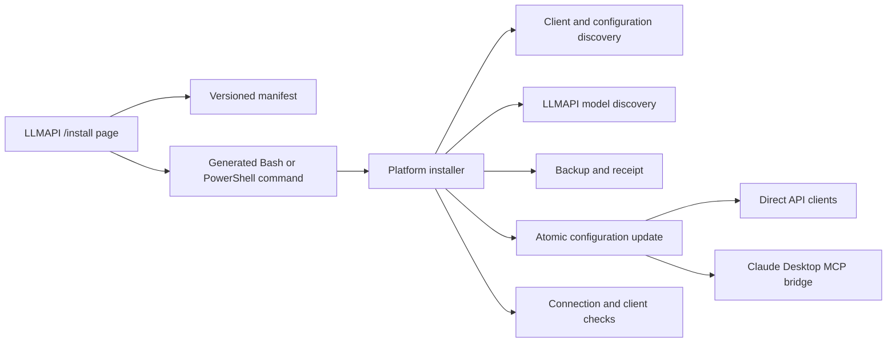

# LLMAPI Client Onboarding Design

**Date:** 2026-08-11

**Status:** Approved in design review; pending written-spec review

## Objective

Replace the legacy Quukk/OpenCode-only connection scripts with a first-party LLMAPI onboarding surface that can configure, explain, verify, back up, and restore supported AI clients on Linux, macOS, and Windows. The same release must support command-line clients, desktop clients, editor integrations, and SDK users without requiring Node.js merely to run the installer.

The public entry point is `/install/` on the LLMAPI deployment being tested. Commands generated by that page target the page's own origin by default so a staging deployment cannot silently configure clients against the production NewAPI domain. Operators and users may override the target explicitly.

## Product Boundary

The onboarding system supports two integration modes:

1. **Direct model access:** the client sends OpenAI Responses/Chat Completions or Anthropic Messages requests to LLMAPI and uses LLMAPI as its model provider.
2. **MCP tool access:** a desktop product that does not permit replacement of its own conversation model can invoke LLMAPI models through a managed MCP tool.

The installer must label these modes instead of implying that MCP replaces a desktop application's built-in model. In particular, Claude Desktop is supported through MCP; Claude Code is supported through direct Anthropic-compatible model access.

The first release covers:

| Client | Platforms | Integration | Delivery |
| --- | --- | --- | --- |
| Codex CLI | Linux, macOS, Windows | Direct Responses API | Automatic |
| Codex Desktop | Supported desktop platforms | Direct Responses API using the Codex user configuration | Automatic where the installed app supports custom providers; otherwise guided launch/configuration |
| Claude Code | Linux, macOS, Windows | Direct Anthropic Messages API | Automatic |
| Claude Desktop | macOS, Windows | MCP tool access to LLMAPI | Automatic configuration merge plus managed bridge |
| OpenCode | Linux, macOS, Windows | Direct OpenAI-compatible API | Automatic |
| Continue | Linux, macOS, Windows | Direct OpenAI-compatible API | Automatic when its user configuration is discoverable |
| Aider | Linux, macOS, Windows | Direct OpenAI-compatible API | Automatic |
| Cursor | Desktop | Direct OpenAI-compatible API | Generated settings and instructions |
| Cline | Desktop | Direct OpenAI-compatible API | Generated settings and instructions |
| Roo Code | Desktop | Direct OpenAI-compatible API | Generated settings and instructions |
| OpenAI Python/Node SDK | Any supported runtime | Direct OpenAI-compatible API | Generated examples |
| LangChain | Any supported runtime | Direct OpenAI-compatible API | Generated examples |

Automatic mutation is limited to clients whose documented, user-owned configuration files can be updated safely. UI-managed or unstable internal stores receive copyable instructions rather than brittle filesystem edits.

## Delivery Architecture

The web build publishes the following assets:

```text
web/public/install/
  index.html
  manifest.json
  install.sh
  install.ps1
  guide.md
  checksums.txt
```

The manifest is the single source of truth for:

- client identifiers, display names, platforms, and integration modes;
- known configuration locations and configuration strategy versions;
- protocol and model compatibility hints;
- downloadable helper artifacts and their checksums;
- minimum installer/manifest schema versions;
- fallback models and smoke-test capabilities.

Linux and macOS share a POSIX-oriented Bash entry point. Windows uses PowerShell. The scripts may download a signed or checksummed platform helper when a protocol implementation cannot be expressed safely in shell, but running the basic installer does not require Node.js. Public assets and helper artifacts use LLMAPI naming; legacy `codex-gateway` names are accepted only as migration inputs where compatibility is necessary.

The install page derives its server URL from `window.location.origin` and generates commands that provide that value to the installer. Users may copy either an interactive command or a deterministic non-interactive command.



## Inputs and Precedence

The server URL is resolved in this order:

1. `--server-url` command option;
2. `LLMAPI_SERVER_URL` environment variable;
3. the origin embedded by the install-page command;
4. interactive prompt, if no safe default exists.

The URL is normalized once. Client adapters receive either the origin or the correctly suffixed `/v1` endpoint, according to the client's contract. Invalid schemes, embedded credentials, fragments, and ambiguous URLs are rejected. HTTPS is required except for explicit loopback development targets.

The API token is resolved in this order:

1. `LLMAPI_TOKEN` environment variable for automation;
2. a hidden interactive prompt.

The token is not accepted as a normal command-line argument because process listings and shell history may expose it. Installer, doctor, exception, receipt, and debug output redact credential-shaped values.

Clients are selected interactively or through `LLMAPI_CLIENTS`, a comma-separated allow-listed set. Unknown client names fail before any configuration is changed. Non-interactive operation fails closed when required inputs are absent.

## Model Discovery and Selection

After authenticating, the installer requests `/v1/models` from the selected LLMAPI origin. The user can choose from the returned public model identifiers. Client/protocol hints from `manifest.json` filter or rank the choices without hiding an explicitly requested compatible model.

If model discovery is temporarily unavailable, the installer may use the versioned fallback list in the manifest only after warning that it can be stale. A connection test still has to authenticate against the live server before an installation is reported successful.

The manifest records which test shape to use for each client:

- Responses for Codex;
- Anthropic Messages for Claude Code;
- Chat Completions for OpenCode, Continue, Aider, editor integrations, and SDK examples;
- MCP initialize/list-tools/tool-call for Claude Desktop.

## Configuration Behavior

### Shared Safety Contract

Every automatic client adapter follows the same transaction:

1. Resolve and validate the user-owned target path.
2. Reject unsafe ownership, a destination symlink, or a parent path that escapes the expected home/config directory.
3. Read and parse the existing configuration without discarding unknown fields.
4. Create a timestamped backup before mutation.
5. Write a temporary file in the destination directory, set restrictive permissions, flush, and atomically replace the target.
6. Re-read and validate the resulting configuration.
7. Record a secret-free receipt containing hashes, paths, adapter version, server origin, selected public model, and backup reference.

On POSIX systems, credential and receipt files are mode `0600` and private directories are mode `0700`. On Windows, the installer applies a current-user-only ACL where supported and warns/fails rather than claiming secure storage when it cannot do so.

Repeating the same installation is idempotent. Existing unrelated providers, MCP servers, editor settings, comments where the format permits them, and unknown fields are preserved. A partial failure restores all files modified by that transaction.

### Codex CLI and Codex Desktop

Codex CLI and Codex Desktop are treated as two consumers of the same Codex user configuration rather than two independent installations. The adapter manages an `llmapi` model provider in `~/.codex/config.toml`, uses the Responses wire protocol, and does not overwrite unrelated providers.

The adapter separately verifies that the API-key mechanism is available to the launched desktop process. Shell-profile configuration alone is not considered sufficient proof for an app started outside a shell. Platform-specific desktop launch integration is used only when it can be installed reversibly; otherwise the installer emits the exact supported launch/configuration step and marks desktop verification pending instead of claiming success.

Doctor checks configuration parsing, provider selection, credential availability, `/v1/models`, and a minimal Responses request. A restart prompt is displayed when a running desktop process cannot reload configuration dynamically.

### Claude Code

The Claude Code adapter manages the supported Anthropic gateway variables, including the normalized base URL, authentication token source, and selected model identifiers. Managed blocks are clearly delimited and merged rather than appended repeatedly. Existing Bedrock, Vertex, or unrelated Anthropic settings are not silently removed.

Doctor executes an Anthropic Messages probe directly and, when the `claude` executable is installed, a bounded non-interactive Claude Code probe with secrets redacted.

### Claude Desktop

Claude Desktop does not expose a supported setting that replaces the model used by its own chat surface. Its adapter therefore configures LLMAPI as an MCP tool and labels the result **MCP tool access**.

The installation safely merges an `llmapi` entry into the platform's `claude_desktop_config.json`. A small managed, cross-platform bridge speaks MCP over stdio and forwards bounded tool calls to LLMAPI. The desktop configuration stores only the bridge command and a path to a private LLMAPI credential/config file; receipts never contain the token.

The initial bridge surface is intentionally narrow:

- `llmapi_list_models` lists public models;
- `llmapi_chat` performs a bounded non-streaming model request;
- returned errors are normalized and credential-free.

The bridge enforces input and output size limits, request timeouts, a configured model allow-list, and an HTTPS/loopback URL policy. It does not expose arbitrary HTTP requests, shell execution, filesystem access, or an unrestricted proxy. Helper binaries are selected by OS/architecture and verified against `checksums.txt` before installation.

Doctor validates the JSON merge, bridge checksum, credential-file permissions, MCP initialization, tool discovery, and an optional low-token tool call. Claude Desktop must be restarted after its MCP configuration changes.

### OpenCode, Continue, and Aider

Each adapter updates only an LLMAPI-namespaced provider or managed block. Existing default models are changed only when the user explicitly selects that option. Continue configuration is mutated automatically only when the installed version and user configuration format match a tested strategy from the manifest; otherwise generated settings are used.

### Cursor, Cline, Roo Code, SDKs, and LangChain

The installer and web page generate settings containing the normalized base URL, selected public model, protocol, and the name of the environment variable that should contain the token. The page never renders the token into generated HTML, copied commands, analytics, or URLs.

Instructions are versioned by manifest entries and clearly separate LLMAPI's origin from `/v1` endpoints. SDK examples include a minimal model-list request and one bounded inference request.

## Backup, Receipt, Restore, and Uninstall

Receipts live under a private LLMAPI state directory and identify a complete transaction. The installer supports:

- listing receipts without secrets;
- restoring the latest transaction;
- restoring a selected transaction;
- removing only LLMAPI-managed blocks or provider entries;
- refusing restore when the current file no longer matches the configured hash, unless the user resolves the conflict explicitly.

Restore is itself transactional and creates a pre-restore backup. Removing Claude Desktop support also removes the managed bridge only when no remaining receipt references it.

The existing TypeScript CLI's internal restore capability is exposed consistently or reused as an implementation reference, but the public installer remains usable without installing that Node package.

## Doctor and Connection Tests

Doctor has read-only checks by default:

- server URL policy and DNS/TLS reachability;
- health and status endpoints;
- authentication and `/v1/models` response;
- local configuration syntax and expected managed entries;
- credential presence and filesystem protection;
- helper checksum/version where applicable;
- mismatch between selected client protocol and selected model route.

An inference smoke test is opt-in in interactive mode and explicit in non-interactive mode because it can consume quota. It uses minimal output limits and reports protocol, public model, HTTP status, latency, and request ID without echoing prompt content or credentials.

Quick Tunnel is accepted for web assets and bounded non-streaming HTTP tests. Its SSE limitation means release evidence for streaming uses direct server access or a stable domain that supports streaming; Quick Tunnel streaming results are not used to classify an LLMAPI defect.

## Web Experience

`/install/` provides:

- operating-system detection with a manual override;
- direct-access versus MCP labels;
- selectable client cards;
- server-origin display and explicit override;
- interactive and non-interactive command generation;
- copy buttons with accessible success/error feedback;
- model discovery with a visible fallback warning;
- generated manual settings for UI-only clients;
- security, backup, restore, doctor, and uninstall documentation;
- a compatibility matrix and known limitations.

The page is static except for same-origin model/status requests. It does not collect tokens. It remains functional without JavaScript through `guide.md` and direct script links.

## Testing Strategy

### Installer and Adapter Tests

- Run all tests with disposable HOME and platform fixture directories.
- Test Bash syntax and ShellCheck where available.
- Parse PowerShell on supported CI runners and run Pester coverage for its configuration functions.
- Use a mock LLMAPI server for health, authentication, models, Responses, Chat Completions, Anthropic Messages, malformed payload, timeout, and quota-error cases.
- Cover fresh install, merge, repeated install, interrupted write, rollback, restore, uninstall, unsafe symlink, wrong ownership, restrictive permissions/ACLs, manifest incompatibility, checksum failure, and output redaction.
- Use golden fixtures for every supported client configuration strategy.
- Test Codex CLI/Desktop shared-state behavior and desktop credential visibility independently.
- Test Claude Desktop JSON preservation, bridge MCP initialization, list-tools, bounded tool calls, and failure redaction.

### Repository and UI Gates

- Run the repository's backend verification script and relevant focused Go tests.
- Run frontend formatting, lint, type checks, unit tests, production build, and copyright checks.
- Run existing CLI tests and type checks.
- Extend Playwright coverage for `/install/` on desktop and mobile: OS/client selection, integration labels, model success/fallback, command generation, copy interaction, manual instructions, and no-token DOM/URL leakage.
- Build the Docker image and verify every published install asset from the running container.

### Real-System Certification

On `113.249.120.24`, deploy a new immutable LLMAPI image to the existing parallel staging service without switching `llmapi.quukk.com` away from NewAPI. Preserve the target database, Redis separation, current image reference, and rollback command.

Certification uses disposable local profiles or test users and verifies:

- public `/install/` access;
- a real install, repeat install, doctor, restore, and uninstall;
- Codex CLI and Desktop configuration behavior;
- Claude Code direct Messages behavior;
- Claude Desktop MCP initialization and tool call;
- OpenCode, Continue, and Aider configuration and at least one representative real request;
- generated Cursor, Cline, Roo Code, SDK, and LangChain settings against live model metadata;
- non-streaming inference through the public staging origin;
- streaming through direct server access or a streaming-capable domain;
- container health, logs, database isolation, and no NewAPI regression.

Desktop certification is performed on operating systems where the corresponding official application is available. An unavailable application is reported as unexecuted evidence, not silently marked passed.

## Deployment and Release

1. Build scripts, bridge binaries, static assets, and `checksums.txt` from the same revision.
2. Run local and CI verification, including container asset tests.
3. Commit and push intentional source and generated release metadata to the private `NeoMei/LLMAPI` repository.
4. Build an immutable image tagged with the release version and commit.
5. Back up staging configuration and record the current rollback image.
6. Recreate only the parallel `llmapi` service and its public test tunnel/route as required.
7. Run health, asset, protocol, installer, UI, and log checks.
8. Roll back automatically if health or mandatory certification fails.
9. Publish a private GitHub prerelease with checksums, helper artifacts, support matrix, test evidence, known limitations, image identifier, and staging install URL.

The production NewAPI container, database, Nginx upstream, and domain remain unchanged until a separately approved cutover.

## Completion Criteria

The onboarding work is complete only when:

- no public install page or generated command references the legacy Quukk installer or silently defaults to `llmapi.quukk.com` while running on staging;
- all automatic adapters preserve unrelated configuration and pass idempotency, backup, restore, uninstall, and security tests;
- tokens do not appear in command arguments, receipts, generated web content, normal logs, or test evidence;
- Codex CLI/Desktop, Claude Code, OpenCode, Continue, and Aider have either verified automatic configuration or an explicit version-gated fallback;
- Claude Desktop has a verified MCP configuration and managed bridge, while the UI states that its built-in conversation model is not replaced;
- Cursor, Cline, Roo Code, OpenAI SDK, and LangChain receive tested, copyable settings;
- backend, frontend, CLI, Playwright, container, and real staging certification gates pass;
- the immutable staging deployment is healthy and NewAPI remains unaffected;
- source, artifacts, checksums, evidence, version/tag, and private GitHub prerelease are published.

## Known Constraints

- Quick Tunnel is temporary and unsuitable as release evidence for SSE streaming.
- Desktop application capabilities and configuration formats can change; automatic strategies are version-gated and fail closed when unknown.
- Claude Desktop integration is MCP tool access, not a replacement for Claude Desktop's built-in chat model.
- A real desktop certification requires access to the corresponding installed application and operating system.
- Production domain cutover is outside this design and requires separate approval.
